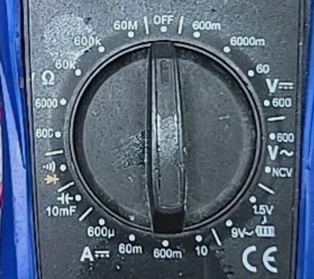

# Cen-Tech CM300 multimeter

Harbor Freight DMM used for identifying unmarked SMD parts on the VFBMS32 / qfbms32 boards.

## Dial ranges (clockwise from OFF)

| Setting | Use |
|---|---|
| **OFF** | Power off |
| **V⎓** 6000m / 60 / 600 | DC voltage (board powered) |
| **V~** 600 | AC voltage |
| **NCV** | Non-contact voltage |
| **Battery** 1.5V / 9V | Battery test |
| **A⎓** 10 / 600m / 60m / 600μ | DC current (inline) |
| **⊣⊢ 10mF** | Capacitance |
| **Diode / continuity** | Diode drop + beep continuity |
| **Ω** 600 / 6000 / 60k / 600k / 60M | Resistance |

## ID’ing an unmarked 0603 (power board OFF first)

Probes on the two metal end caps.

| Test | Reading | Likely part |
|---|---|---|
| **Ω** | ~0 Ω (or a few ohms) | Ferrite bead (or short) |
| **Ω** | Stable ohms (10, 100, 1k…) | Resistor |
| **Ω** | Climbs toward OL / open | Capacitor (meter charging it) |
| **Capacitance** | Any clear nF/µF reading | Capacitor (in-circuit value may be wrong) |
| **Continuity** | Hard beep | Bead / short |
| **Continuity** | No beep | Open / cap / high-R |

### Caveats

- Never use Ω / capacitance / continuity on a **live** board.
- In-circuit parallel paths can fake a low reading — if unsure, lift one end and recheck.
- Capacitance in-circuit is often inaccurate (other caps on the same nets); a non-zero reading still confirms “it’s a cap.”

## Related board context

Box 1 at **(29.15, 5.70)** — measured **9.97 on 60k Ω ≈ 10 kΩ**. Placed as `R_SSR2` 10k 0603 (was unmarked; broke off during probe).
